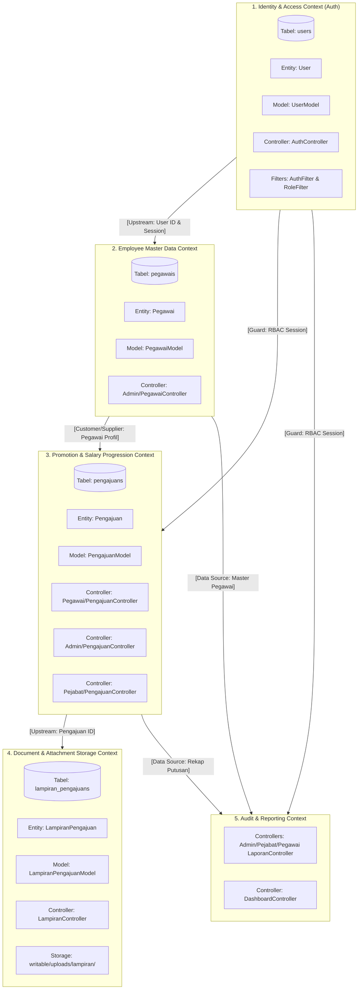
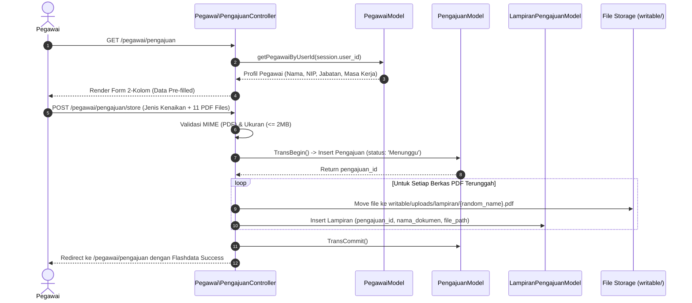
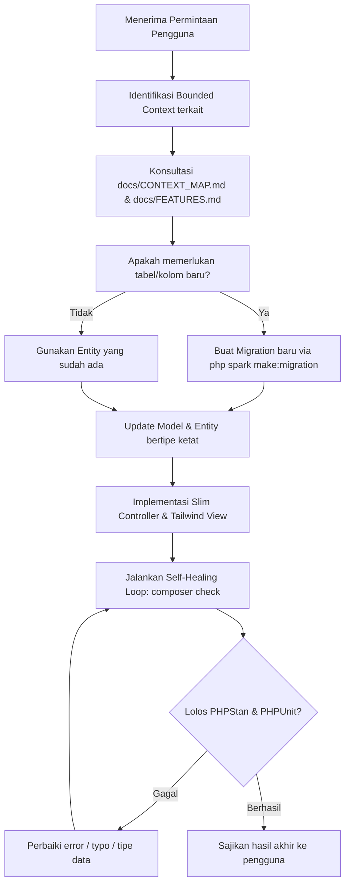

# SIGAP Architecture & AI Context Map (CONTEXT_MAP.md)

Dokumen ini adalah **Peta Konteks (Context Map)** berbasis prinsip *Domain-Driven Design (DDD)* untuk memandu agen AI (Antigravity, Cursor, Claude, Copilot) dan pengembang dalam menavigasi, memahami batas-batas domain (*bounded contexts*), relasi antar komponen, serta berkas yang harus disentuh saat melakukan penambahan atau perubahan fitur.

---

## 1. Diagram Peta Konteks Domain (Bounded Context Map)

---

## 2. Definisi & Batasan Domain (Bounded Contexts)

### A. Identity & Access Context (`App\Entities\User`)
* **Tanggung Jawab**: Autentikasi kredensial (NIP & bcrypt password), manajemen sesi (`isLoggedIn`, `role`), dan proteksi rute (`AuthFilter`, `RoleFilter`).
* **Hubungan**: Bertindak sebagai *Upstream* bagi seluruh konteks lainnya. Setiap interaksi pengguna harus divalidasi oleh konteks ini.
* **Tabel Terkait**: `users`.

### B. Employee Master Data Context (`App\Entities\Pegawai`)
* **Tanggung Jawab**: Pengelolaan profil pegawai (Nama, NIP, Jabatan/Golongan, Masa Kerja). Hanya dapat dimanipulasi (*write*) oleh Administrator.
* **Hubungan**: Menyediakan data identitas bagi *Progression Context* saat pengajuan dibuat.
* **Tabel Terkait**: `pegawais` (berelasi 1:1 dengan `users`).

### C. Promotion & Salary Progression Context (`App\Entities\Pengajuan`)
* **Tanggung Jawab**: Inti bisnis SIGAP. Menangani alur pembuatan pengajuan kenaikan pangkat / kenaikan gaji berkala oleh Pegawai, telaah dan persetujuan/penolakan oleh Pejabat Penilai, serta monitoring oleh Administrator.
* **Hubungan**: *Downstream* dari Pegawai, dan *Upstream* bagi Dokumen Lampiran.
* **Tabel Terkait**: `pengajuans`.

### D. Document & Attachment Storage Context (`App\Entities\LampiranPengajuan`)
* **Tanggung Jawab**: Upload aman berkas PDF (11 jenis dokumen usulan), validasi tipe MIME & ukuran (maks 2MB), penamaan acak terenkripsi, penyimpanan fisik di disk (`writable/uploads/lampiran/`), serta streaming pratinjau inline di peramban.
* **Hubungan**: Dimiliki secara mutlak oleh *Progression Context* (Cascading Delete: jika pengajuan dihapus, berkas fisik dan record di database ikut terhapus).
* **Tabel Terkait**: `lampiran_pengajuans`.

### E. Audit & Reporting Context
* **Tanggung Jawab**: Agregasi data untuk metrik Dashboard (KPI cards) dan rekapitulasi riwayat pengajuan yang sudah diputuskan (*Disetujui* / *Ditolak*), serta riwayat transparan untuk Pegawai.
* **Hubungan**: *Read-only Consumer* dari konteks Pegawai dan Progression.

---

## 3. Matriks Navigasi Cepat AI (AI Touchpoint Matrix)

Gunakan tabel ini sebagai kompas instan: **"Jika ingin mengubah fitur X, berkas apa saja yang harus disentuh?"**

| Kebutuhan Fitur / Perubahan | Controller | Model & Entity | Views | Database / Migration |
| :--- | :--- | :--- | :--- | :--- |
| **Ubah Logika Login / Role / Sesi** | `app/Controllers/AuthController.php` | `UserModel.php` `User.php` | `app/Views/auth/login.php` | `2026-10-17-041002_CreateUsersTable.php` |
| **Proteksi Hak Akses Rute Baru** | `app/Config/Routes.php` | `app/Filters/RoleFilter.php` `AuthFilter.php` | - | - |
| **CRUD Data Pegawai (Admin)** | `app/Controllers/Admin/PegawaiController.php` | `PegawaiModel.php` `Pegawai.php` | `app/Views/admin/pegawai/index.php` | `2026-10-17-041016_CreatePegawaisTable.php` |
| **Form Usulan Pegawai (+Slot Berkas)**| `app/Controllers/Pegawai/PengajuanController.php` | `PengajuanModel.php` `Pengajuan.php` | `app/Views/pegawai/pengajuan/create.php` | `2026-10-17-041017_CreatePengajuansTable.php` |
| **Review / Setujui / Tolak Usulan** | `app/Controllers/Pejabat/PengajuanController.php` | `PengajuanModel.php` `Pengajuan.php` | `app/Views/pejabat/pengajuan/index.php` | - |
| **Upload, Pratinjau & Unduh PDF** | `app/Controllers/LampiranController.php` | `LampiranPengajuanModel.php` `LampiranPengajuan.php` | Modal PDF di `Views/admin/`, `pejabat/`, `pegawai/` | `2026-10-17-041018_CreateLampiranPengajuansTable.php` |
| **Laporan & Filter Hasil Keputusan** | `app/Controllers/*/LaporanController.php` | `PengajuanModel.php` | `app/Views/*/laporan/index.php` | - |
| **Kartu Statistik Dashboard** | `app/Controllers/DashboardController.php` | `PegawaiModel.php` `PengajuanModel.php` | `app/Views/*/dashboard.php` | - |
| **Perubahan Warna / Sidebar / Layout**| - | - | `app/Views/layouts/main.php` | - |

---

## 4. Diagram Alur Data Lintas Konteks (Cross-Context Data Flow)

### Skenario: Pegawai Mengajukan Kenaikan Gaji / Pangkat

---

## 5. Protokol Pengambilan Keputusan untuk AI Agent

Saat AI diminta melakukan tugas baru di codebase ini, AI **wajib** mengikuti alur keputusan berikut:

> **Aturan Portabilitas Dokumentasi**: Setiap referensi berkas dalam dokumentasi wajib menggunakan path relatif (contoh: `docs/FEATURES.md` atau `app/Controllers/AuthController.php`), dilarang menggunakan path absolut mesin lokal agar proyek tetap kompatibel di semua perangkat.

