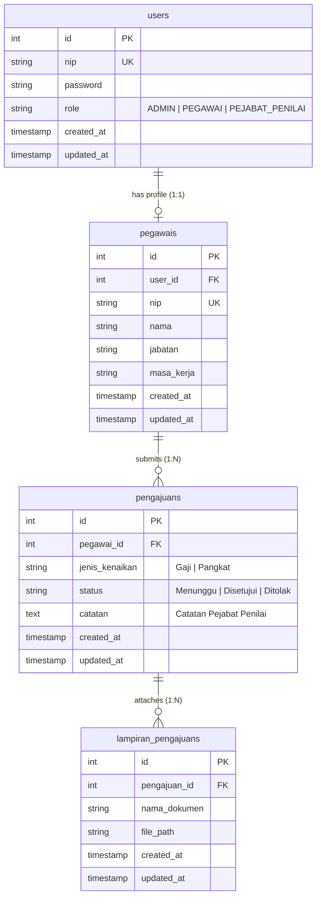
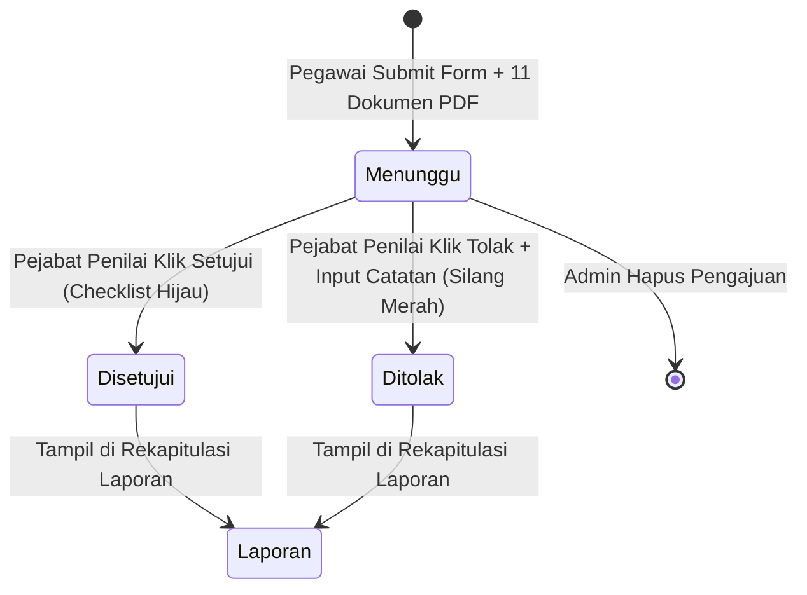

# Dokumentasi Fitur & Spesifikasi Sistem SIGAP (FEATURES.md)

Dokumen ini menyediakan spesifikasi lengkap, kamus data, aturan bisnis, dan pemetaan alur sistem **SIGAP (Sistem Kenaikan Gaji dan Pangkat - DLH Kabupaten Bengkalis)** yang dirancang agar terstruktur rapi dan **100% AI-Friendly**.

---

## 1. Diagram Relasi Entitas & Database (ERD)



---

## 2. Matriks Hak Akses Berbasis Peran (RBAC)

| Modul / Fitur | Administrator (`ADMIN`) | Pejabat Penilai (`PEJABAT_PENILAI`) | Pegawai (`PEGAWAI`) |
| :--- | :---: | :---: | :---: |
| **Login & Logout** | ✅ | ✅ | ✅ |
| **Dashboard KPI Statistik** | ✅ (3 KPI Cards) | ✅ (Ringkasan Pengawasan) | ✅ (Status Usulan Mandiri) |
| **Data Pegawai (Lihat / Search)** | ✅ | ❌ | ❌ |
| **Data Pegawai (Tambah / Edit / Hapus)**| ✅ | ❌ | ❌ |
| **Buat Pengajuan Kenaikan (+11 PDF)** | ❌ | ❌ | ✅ |
| **Monitoring Pengajuan Masuk** | ✅ (Daftar & Lampiran) | ✅ (Daftar & Review) | ❌ |
| **Persetujuan / Penolakan Berkas** | ❌ | ✅ (Setujui / Tolak + Catatan) | ❌ |
| **Hapus Pengajuan & File Fisik** | ✅ | ❌ | ❌ |
| **Pratinjau / Unduh Berkas PDF** | ✅ | ✅ | ✅ (Milik Sendiri) |
| **Laporan Hasil Putusan** | ✅ (Seluruh Pegawai) | ✅ (Seluruh Putusan) | ✅ (Khusus Akun Sendiri) |

---

## 3. Spesifikasi Rinci Setiap Fitur

### A. Modul Autentikasi & Sesi
- **Endpoint**:
  - `GET /login`: Menampilkan form login (Redirect ke `/dashboard` jika sudah login).
  - `POST /login`: Memvalidasi `nip` dan `password`, mengecek hash bcrypt di tabel `users`.
  - `GET /logout`: Menghancurkan session dan redirect ke `/login`.
- **Session Data yang Disimpan**:
  - `user_id` (int): ID dari tabel `users`.
  - `nip` (string): Nomor Induk Pegawai.
  - `role` (string): `ADMIN`, `PEGAWAI`, atau `PEJABAT_PENILAI`.
  - `nama` (string): Nama lengkap pegawai/pejabat.
  - `jabatan` (string): Jabatan pegawai/pejabat.
  - `isLoggedIn` (bool): Flag status autentikasi `true`.
- **Pengamanan (Filters)**:
  - `AuthFilter`: Memeriksa session `isLoggedIn`. Jika tidak ada, redirect ke `/login` dengan error *"Silakan login terlebih dahulu"*.
  - `RoleFilter`: Memeriksa apakah role pengguna sesuai dengan parameter route (misal: `role:ADMIN`). Jika tidak cocok, redirect ke `/dashboard` dengan pesan *"Akses ditolak"*.

---

### B. Modul Dashboard (`/dashboard`)
- **Controller**: `App\Controllers\DashboardController::index`
- **Tampilan Sesuai Peran**:
  1. **ADMIN** (`app/Views/admin/dashboard.php`):
     - Berpedoman pada `public/ui-design/halaman-dashboard(hak-akses-admin).png`.
     - 3 Kartu Statistik Hijau `#2D6A4F`:
       * **Jumlah Pegawai**: `SELECT COUNT(*) FROM pegawais`.
       * **Jumlah Pengajuan**: `SELECT COUNT(*) FROM pengajuans`.
       * **Jumlah Laporan**: `SELECT COUNT(*) FROM pengajuans WHERE status IN ('Disetujui', 'Ditolak')`.
  2. **PEJABAT PENILAI** (`app/Views/pejabat/dashboard.php`):
     - Kartu statistik: Usulan Menunggu Tindakan, Usulan Disetujui, Usulan Ditolak.
     - Tabel ringkasan 5 pengajuan terbaru yang membutuhkan verifikasi segera.
  3. **PEGAWAI** (`app/Views/pegawai/dashboard.php`):
     - Ringkasan profil (Nama, NIP, Jabatan, Masa Kerja).
     - Matriks status pengajuan pribadi & tombol cepat *"Ajukan Kenaikan Baru"*.

---

### C. Modul Data Pegawai (Khusus `ADMIN`)
- **Controller**: `App\Controllers\Admin\PegawaiController`
- **Desain UI**: `public/ui-design/halaman-data-pegawai(hak-akses-admin).png`
- **Aturan Bisnis & Transaksi Database**:
  - **Tambah Pegawai (`POST /admin/pegawai/store`)**:
    1. Validasi input: `nama` (required), `nip` (required, unique di `users`), `password` (min 6 karakter), `jabatan` (required), `masa_kerja` (required).
    2. Eksekusi database transaction:
       - Insert ke `users`: `nip`, `password` (hash bcrypt), `role = 'PEGAWAI'`.
       - Insert ke `pegawais`: `user_id` (FK baru), `nip`, `nama`, `jabatan`, `masa_kerja`.
  - **Ubah Pegawai (`POST /admin/pegawai/update/{id}`)**:
    1. Update data profil di `pegawais`.
    2. Sinkronisasi NIP ke tabel `users`.
    3. Jika password diisi, update password hash baru di `users`.
  - **Hapus Pegawai (`POST /admin/pegawai/delete/{id}`)**:
    - Menghapus record di `pegawais` dan menghapus user terkait di `users`.
    - Relasi database PostgreSQL dikonfigurasi `ON DELETE CASCADE`.
  - **Pencarian & Filter**:
    - Parameter `q`: Pencarian *case-insensitive* (`ILIKE`) pada kolom `nama`, `nip`, `jabatan`, `masa_kerja`.
    - Parameter `jabatan`: Filter eksak pilihan jabatan.
    - Dilengkapi *Live Search* instan di sisi klien via JavaScript.

---

### D. Modul Pengajuan Kenaikan
- **Alur & Siklus Hidup Status (State Machine)**:


- **Fitur Pegawai (`/pegawai/pengajuan`)**:
  - Desain UI: `public/ui-design/halaman-tambah-pengajuan-kenaikan(hak-akses-pegawai).png`.
  - Grid 2 kolom berlatar hijau muda:
    * **Data Profil (Readonly Otomatis)**: Nama, NIP, Jabatan, Masa Kerja.
    * **Jenis Kenaikan**: Opsi radio/pill toggle antara *"Kenaikan Gaji Berkala"* atau *"Kenaikan Pangkat"*.
    * **11 Slot Dokumen Lampiran (Format PDF, Maks 2MB per file)**:
      1. `surat_rekomendasi` &rarr; Surat Rekomendasi
      2. `scan_skp` &rarr; Scan SKP
      3. `sk_terakhir` &rarr; Fotokopi SK Terakhir
      4. `ijazah_transkrip` &rarr; Fotokopi Ijazah & Transkrip Nilai
      5. `daftar_riwayat_hidup` &rarr; Daftar Riwayat Hidup
      6. `surat_bebas_hukuman` &rarr; Surat Pernyataan Tidak Sedang Dalam Hukuman Disiplin
      7. `keterangan_sehat` &rarr; Surat Keterangan Sehat
      8. `bukti_pelatihan` &rarr; Bukti Pelatihan
      9. `kartu_keluarga` &rarr; Kartu Keluarga
      10. `formulir_usulan` &rarr; Formulir Usulan Kenaikan Pangkat
      11. Berkas pendukung opsional lainnya.
  - Berkas PDF disimpan dengan penamaan acak aman di folder [`writable/uploads/lampiran/`](../writable/uploads/lampiran) dan relasinya dicatat ke tabel `lampiran_pengajuans`.

- **Fitur Admin (`/admin/pengajuan`)**:
  - Desain UI: `public/ui-design/halaman-data-pengajuan-kenaikan(hak-akses-admin).png`.
  - Tabel memuat seluruh pengajuan pegawai.
  - Badge PDF hitam interaktif yang memicu modal untuk membuka dan mengunduh berkas.
  - Tombol hapus (icon tempat sampah) yang membersihkan record database sekaligus menghapus file fisik di disk.

- **Fitur Pejabat Penilai (`/pejabat/pengajuan`)**:
  - Desain UI: `public/ui-design/halaman-data-pengajuan-kenaikan(hak-akses-pejabat-penilai).png`.
  - 3 Aksi Utama:
    * **👁️ Pratinjau**: Membuka modal detail pengajuan, biodata lengkap, dan tautan seluruh lampiran.
    * **✅ Setujui**: Mengubah status menjadi `'Disetujui'` seketika.
    * **❌ Tolak**: Menampilkan modal untuk menginput alasan penolakan dan mengubah status menjadi `'Ditolak'`.

---

### E. Modul Laporan & Tracking
- **Desain UI**:
  - Admin & Pejabat: `public/ui-design/halaman-data-laporan(hak-akses-admin-dan-pejabat-penilai).png`.
  - Pegawai: `public/ui-design/halaman-data-laporan(hak-akses-pegawai).png`.
- **Dispatcher Otomatis (`GET /laporan`)**:
  - Jika role `ADMIN` &rarr; diarahkan ke `/admin/laporan`.
  - Jika role `PEJABAT_PENILAI` &rarr; diarahkan ke `/pejabat/laporan`.
  - Jika role `PEGAWAI` &rarr; diarahkan ke `/pegawai/laporan`.
- **Query Scope**:
  - **Admin & Pejabat Penilai**: Menampilkan semua pengajuan yang statusnya sudah diputuskan (`status IN ('Disetujui', 'Ditolak')`).
  - **Pegawai**: Hanya menampilkan riwayat pengajuan milik pegawai yang bersangkutan dengan semua status (`Menunggu`, `Disetujui`, `Ditolak`) beserta catatan dari Pejabat Penilai.
- **Fitur Pencarian & Filter**:
  - Filter berdasarkan Jenis Kenaikan: `Semua`, `Gaji`, `Pangkat`.
  - Filter berdasarkan Status: `Semua`, `Disetujui`, `Ditolak`.
  - Pencarian Nama/NIP baik via server query maupun live filtering JavaScript.

---

### F. Modul Lampiran Dokumen (`/lampiran`)
- **Controller**: `App\Controllers\LampiranController`
- **Endpoint**:
  - `GET /lampiran/view/{id}`: Membuka berkas PDF langsung di tab peramban dengan header `Content-Type: application/pdf` dan `Content-Disposition: inline`.
  - `GET /lampiran/download/{id}`: Mengunduh berkas dengan `Content-Disposition: attachment`.
  - `GET /lampiran/list/{pengajuanId}`: Mengembalikan data JSON daftar dokumen lampiran untuk modal dialog.
- **Validasi Keamanan**:
  - Menghindari *path traversal*.
  - Memverifikasi keberadaan berkas fisik sebelum streaming.
  - Memastikan user terautentikasi sebelum file diakses.

---

## 4. Format Respons JSON Standar

Untuk semua pemanggilan asynchronous (AJAX / API), sistem menggunakan struktur response seragam:

**Success Response (HTTP 200)**:
```json
{
  "status": "success",
  "data": {
    "id": 1,
    "nama": "Budi Santoso",
    "nip": "199502152020121002"
  },
  "message": "Operasi berhasil"
}
```

**Error Response (HTTP 400 / 404 / 500)**:
```json
{
  "status": "error",
  "message": "Data pengajuan tidak ditemukan"
}
```

---

## 5. Panduan Pengembangan Bagi AI Agent Berikutnya

Jika Anda (AI atau developer) diminta menambahkan fitur baru atau memodifikasi modul yang sudah ada:
1. **Gunakan Entities**: Jangan pernah menggunakan associative array liar saat manipulasi data. Gunakan class entity di `app/Entities/`.
2. **PostgreSQL Compatibility**:
   - Selalu gunakan `ILIKE` untuk query pencarian teks yang case-insensitive.
   - Primary key auto-increment bertipe `SERIAL` / `BIGSERIAL`.
   - Gunakan tipe data `VARCHAR` atau `TEXT` (bukan MySQL `ENUM`).
3. **Verifikasi Mandiri Wajib**:
   Setiap selesai melakukan perubahan file PHP, jalankan:
   ```bash
   composer check
   ```
   Pastikan PHPStan Level 5 dan PHPUnit keduanya berstatus hijau (`[OK] No errors`).
